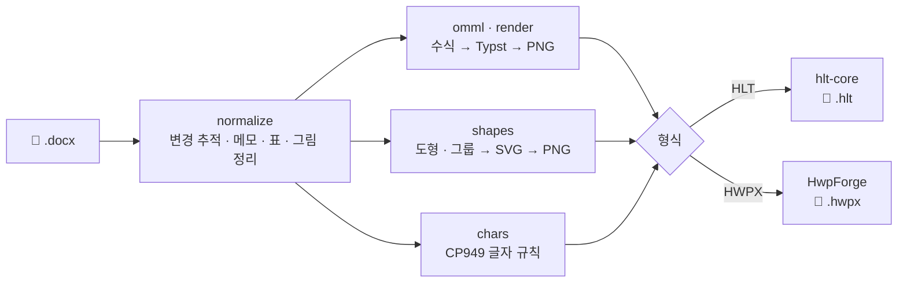

<div align="center">

# 📄 DOCX_2_HWPX_OR_HLT

**워드로 쓴 특허 명세서(`.docx`)를 특허청 전자출원 편집기용 파일로 바꿔 주는 무료 도구**

`.docx` &nbsp;➜&nbsp; `.hlt` (NK-Editor) &nbsp;·&nbsp; `.hwpx` (MOIP-Editor)

[](https://github.com/lmg6983-dotcom/DOCX_2_HWPX_OR_HLT/releases/latest)
[](https://github.com/lmg6983-dotcom/DOCX_2_HWPX_OR_HLT/releases)
[](https://github.com/lmg6983-dotcom/DOCX_2_HWPX_OR_HLT/actions/workflows/windows.yml)
[](LICENSE)
[](https://www.rust-lang.org)


<br>

[](https://github.com/lmg6983-dotcom/DOCX_2_HWPX_OR_HLT/releases/latest/download/docx2hwpx-hlt-windows-x64.zip)
&nbsp;
[](https://github.com/lmg6983-dotcom/DOCX_2_HWPX_OR_HLT/releases/latest/download/docx2hwpx-hlt-cli-windows-x64.zip)

[내려받기](#-내려받기) •
[쓰는 법](#-쓰는-법) •
[자동으로 처리하는 것](#%EF%B8%8F-자동으로-처리하는-것) •
[명령줄](#%EF%B8%8F-명령줄-버전) •
[직접 빌드](#%EF%B8%8F-직접-빌드하기) •
[변경 기록](CHANGELOG.md)

</div>

---

| 만드는 파일 | 여는 프로그램 | 서식 |
|:---:|---|---|
| **`.hlt`** | NK-Editor (통합명세서작성기) | 국내 출원 · PCT 국내진입 |
| **`.hwpx`** | MOIP-Editor | 지식재산처 명세서 서식 (A4 · 바탕체 12pt · 줄 간격 280%) |

> [!WARNING]
> 두 형식 모두 **공개 사양이 없습니다.** 바꾼 파일은 반드시 **NK-Editor나 MOIP-Editor에서 열어 확인한 뒤** 제출하세요.

## ✨ 특징

- 🖱️ **끌어다 놓고 한 번 누르면 끝** — 설치 없이 압축만 풀면 되는 Windows 앱
- 🧮 **수식을 깔끔한 그림으로** — 워드 수식(OMML)과 옛 수식 편집기 개체 모두
- 🧹 **제출 전 정리를 대신** — 변경 내용 추적은 모두 반영하고, 메모는 모두 지웁니다
- 🔤 **NK-Editor가 못 쓰는 글자를 알아서** — 첨자 서식 · 비슷한 글자 · 글자 그림으로 바꿉니다
- 🧩 **깨진 표 · 그림도 살려서** — Word는 그려 주지만 편집기가 못 읽는 구조를 고쳐 넣고 알려 줍니다
- 🤖 **자동화 친화적인 CLI** — `--json` 한 줄 출력 · 고정된 오류/경고 코드 ([AGENTS.md](AGENTS.md))
- 🦀 **Rust로 만든 단일 실행 파일** — 네트워크를 쓰지 않으므로 명세서가 밖으로 나가지 않습니다

## 📥 내려받기

> Windows 64비트 · 설치할 필요가 없습니다. 압축을 풀고 실행하면 됩니다.

| 패키지 | 실행 파일 | 이럴 때 |
|---|---|---|
| **[UI 앱](https://github.com/lmg6983-dotcom/DOCX_2_HWPX_OR_HLT/releases/latest/download/docx2hwpx-hlt-windows-x64.zip)** | `docx2hwpx-hlt-gui.exe` | 대부분 이것만 받으면 됩니다 |
| [CLI 버전](https://github.com/lmg6983-dotcom/DOCX_2_HWPX_OR_HLT/releases/latest/download/docx2hwpx-hlt-cli-windows-x64.zip) | `docx2hwpx-hlt.exe` | 여러 파일을 한꺼번에 · 자동화 · PCT 국내진입 서식 |

> [!TIP]
> 처음 실행할 때 Windows가 **"알 수 없는 게시자"** 라며 막으면 **추가 정보 → 실행**을 누르세요.
> 코드 서명 계획은 [CODE_SIGNING.md](CODE_SIGNING.md)에 있습니다.

## 🚀 쓰는 법

```text
 ① 끌어다 놓기         ② 형식 고르기          ③ 변환              ④ 저장
 명세서.docx   ──▶   HLT  ·  HWPX   ──▶   [ 변환 ]   ──▶   명세서.hlt
```

1. 워드 파일(`.docx`)을 창에 끌어다 놓습니다.
2. **HLT** 또는 **HWPX**를 고릅니다.
3. **변환**을 누릅니다.
4. 저장 창이 뜨면 저장합니다. 파일 이름은 그대로 두고 확장자만 바뀝니다(`명세서.docx` → `명세서.hlt`).

바꾸면서 손댄 글자나 확인할 곳이 있으면 창 아래에 **「바꾼 것」 · 「편집기에서 확인할 곳」** 으로 나눠 보여 줍니다.
어디인지는 `【0012】 부근 그림`처럼 식별 번호로 알려 줍니다.

## 🛠️ 자동으로 처리하는 것

| | 항목 | 하는 일 |
|:---:|---|---|
| 🧮 | **수식** | 워드 수식(옛 수식 편집기 개체 포함)을 최소 14pt의 깔끔한 그림으로 넣습니다. |
| 📝 | **변경 내용 추적 · 메모** | 추적한 변경은 모두 반영(수락)하고, 메모는 모두 지운 뒤 바꿉니다. |
| 🖼️ | **표와 그림** | 셀을 합친 표, WMF/EMF 그림을 옮깁니다. ChemDraw 개체는 미리보기 그림으로 넣습니다. |
| 🔷 | **Word 도형 · 그룹** | 그림 · 선 · 화살표 · 글상자를 묶은 그룹(「도형으로 변환」한 ChemDraw 반응식 등)을 원래 배치대로 그림 한 장으로 바꿉니다. |
| Ω | **기호 글꼴** | Symbol · Wingdings · MT Extra 글꼴로 쓴 글(화면에는 α · × · ® · ™ · ✓, 실제로는 `a` · `´` · `Ò`)을 진짜 기호로 바꿉니다. 스타일로 지정한 글꼴도 따라가고, 줄 안 나뉘는 하이픈(Ctrl+Shift+-)도 `-`로 살립니다. |
| 🧩 | **표 구조** | 칸이 모자란 줄, 줄 앞뒤 빈 자리, 표 밖으로 넘친 칸 합치기, 위가 없는 세로 병합처럼 편집기 형식에 맞지 않는 표를 고쳐 넣고 몇 번째 표인지 알려 줍니다. |
| 🩹 | **그림 문제** | SVG는 PNG로 바꿉니다. 파일이 없거나, 읽을 수 없거나, 「파일에 연결」로만 넣은 그림은 「그림 없음」 자리표를 넣고 알려 줍니다. |
| 📦 | **큰 문서** | HLT 변환 한도(64MB)를 넘으면 그림 해상도를 200 → 150 → 100 → 72dpi로 낮춰 맞추고 알려 줍니다. |
| 📐 | **HWPX 서식** | 지식재산처가 정한 명세서 서식(A4, 바탕체 12pt, 줄 간격 280% 등)에 맞춥니다. |

<details>
<summary><b>🔤 HLT에서 쓸 수 없는 글자는 이렇게 바꿉니다</b> (펼치기)</summary>

<br>

NK-Editor는 완성형 한글(**CP949**)에 있는 글자만 저장할 수 있습니다.

| 원래 글자 | 예 | 바꾸는 방법 |
|---|---|---|
| 첨자 모양 글자 | `x²`, `H₂O` | 보통 글자에 위/아래첨자 서식을 붙입니다 |
| 모양이 비슷한 글자 | `–`, `−`, `≈`, `・`, `⋅` | 저장할 수 있는 글자로 바꿉니다 (`-`, `≒`, `·`) |
| 바꿀 수 없는 글자 | `x̂`, `ü` | 글자 모양 그대로 그림으로 넣습니다 *(편집기에서 글자로 고칠 수는 없습니다)* |

</details>

## ⚠️ 알아 둘 점

- 그룹 밖 글상자 안의 글은 옮기지 않습니다(그룹 안 글상자는 그림에 함께 그려집니다).
- 워드 스타일에만 정해 둔 서식(글꼴, 크기 등)은 옮겨지지 않을 수 있습니다. 크기가 정해지지 않은 글은 12pt로 처리합니다.
- HLT는 표의 한 칸에 문단을 하나만 넣을 수 있습니다. 그래서 칸 안의 여러 문단은 한 문단으로 합치고, 칸 안에 든 표는 글로 풉니다.
- 화면 앱은 HLT를 국내 출원 서식으로만 만듭니다. PCT 국내진입 서식은 명령줄 버전에서 만들 수 있습니다.

---

## ⌨️ 명령줄 버전

```bash
docx2hwpx-hlt 명세서.docx --to hlt                       # → 명세서.hlt (국내 출원 서식)
docx2hwpx-hlt 명세서.docx --to hwpx                      # → 명세서.hwpx
docx2hwpx-hlt 명세서.docx --to hlt --pct -o 번역문.hlt   # PCT 국내진입 서식
docx2hwpx-hlt 명세서.docx --to hlt --json                # 결과를 JSON 한 줄로
```

<details>
<summary><b>옵션 전체 보기</b></summary>

<br>

| 옵션 | 뜻 |
|---|---|
| `-t`, `--to <hwpx\|hlt>` | 만들 형식 **(필수)** |
| `-o`, `--output <파일>` | 출력 경로. 없으면 입력 이름에 확장자만 바꿉니다 |
| `--pct` | HLT를 PCT 국내진입 서식으로 (`--to hlt`에만) |
| `--image-dpi <N>` | HLT 그림 해상도 상한 (기본 300, `0`이면 끔) |
| `--overwrite` | 출력이 이미 있으면 덮어씁니다. 끝까지 쓴 뒤 바꿔 넣으므로 실패해도 원래 파일이 남습니다 |
| `--json` | 결과를 표준 출력에 JSON 한 줄로 |
| `--font-dir <폴더>` | 수식 안 한글 · 글자 그림에 쓸 글꼴 폴더 (여러 번 줄 수 있음) |
| `-h`, `--help` · `-V`, `--version` | 도움말 · 판 번호 |

</details>

| 종료 코드 | 뜻 |
|:---:|---|
| `0` | 성공 (경고가 있어도 0) |
| `1` | 변환 실패 — JSON의 `error.code`를 보세요 |
| `2` | 인자가 잘못됨 |

> [!NOTE]
> 자동화나 AI 에이전트로 쓸 때의 JSON 필드 · 오류 코드 · 경고 코드는 [AGENTS.md](AGENTS.md)에 계약으로 정리돼 있습니다.

## 🏗️ 직접 빌드하기

[Rust](https://rustup.rs) (stable, 2024 edition)가 필요합니다.

```bash
cargo build --release                                          # 명령줄 버전
cargo build --release --features gui --bin docx2hwpx-hlt-gui   # 화면 앱
cargo test                                                     # 시험
```

<details>
<summary><b>🗺️ 변환이 흘러가는 길</b></summary>

<br>



| 파일 | 하는 일 |
|---|---|
| `src/lib.rs` | 변환 핵심 `convert` (바이트 → 바이트 + 보고 · 진행 알림) |
| `src/main.rs` · `src/bin/gui.rs` | 명령줄 · 화면 앱(egui) |
| `src/normalize.rs` | DOCX 고쳐 쓰기 — 수식, WMF/EMF, 변경 추적, 칸 합치기, 글자 규칙 |
| `src/tables.rs` · `src/shapes.rs` | 표 구조 바로잡기 · Word 도형을 그림으로 |
| `src/hwpx.rs` | 고쳐 쓴 DOCX → HWPX |

</details>

**릴리스:** `v*` 태그를 올리거나 Actions의 [`windows`](.github/workflows/windows.yml) 워크플로를 수동으로 실행하면서 `release`에 버전(예: `v0.1.6`)을 넣으면 윈도 빌드와 릴리스가 자동으로 만들어집니다.
자세한 순서와 커밋 규칙은 [CONTRIBUTING.md](CONTRIBUTING.md)를 보세요.

## 🤝 기여하기

버그 제보와 제안을 환영합니다. [이슈 열기](https://github.com/lmg6983-dotcom/DOCX_2_HWPX_OR_HLT/issues/new/choose)

> [!CAUTION]
> **실제 출원 전 명세서는 이슈에 올리지 마세요.** 문제를 재현하는 최소한의 예시 문서나, 내용을 지운 문서를 올려 주세요.

## 🙏 바탕이 된 오픈소스

| 이름 | 쓰는 곳 | 라이선스 |
|---|---|---|
| [seoan-editor](https://github.com/tornado1014/seoan-editor) `hlt-core` | DOCX 읽기, HLT 쓰기 | MIT |
| [HwpForge](https://github.com/ai-screams/HwpForge) | HWPX 쓰기 | MIT / Apache-2.0 |
| [Typst](https://github.com/typst/typst) | 수식, 글자 그림 | Apache-2.0 |
| [wmf-rs](https://github.com/mythrnr/wmf-rs), emf-core, [resvg](https://github.com/linebender/resvg) | WMF/EMF · SVG 그림 변환 | MIT, MIT / Apache-2.0 |
| [egui / eframe](https://github.com/emilk/egui) | 화면 앱 | MIT / Apache-2.0 |

## 📄 라이선스

[MIT](LICENSE) © 2026 lmg6983-dotcom

<div align="center">
<sub>특허 실무자의 반복 작업을 덜기 위해 만들었습니다 · 문제가 있으면 <a href="https://github.com/lmg6983-dotcom/DOCX_2_HWPX_OR_HLT/issues">이슈</a>로 알려 주세요</sub>
</div>
